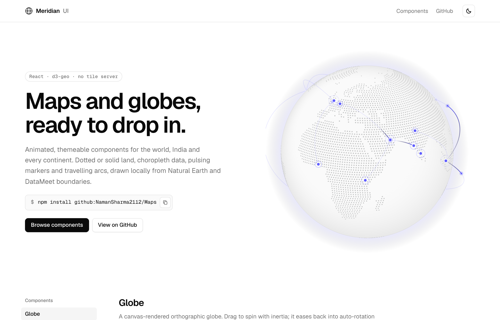
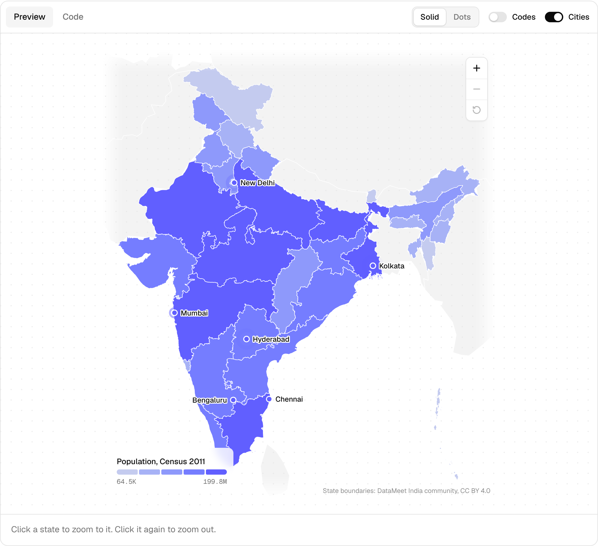
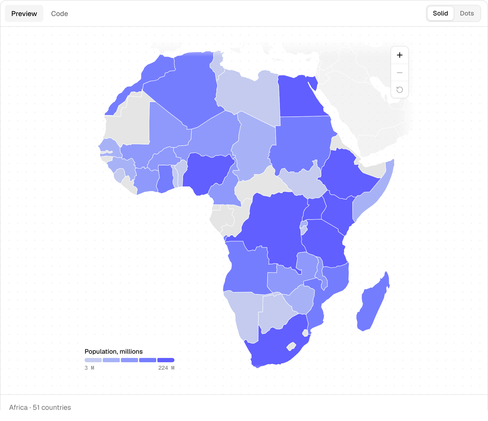
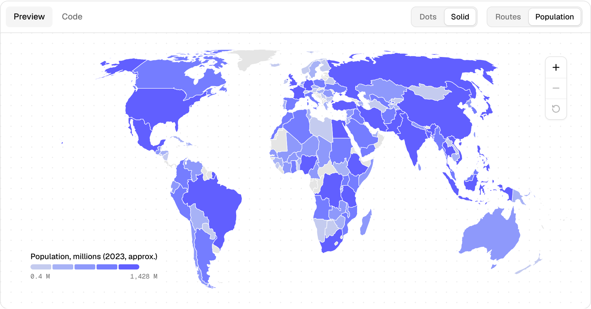
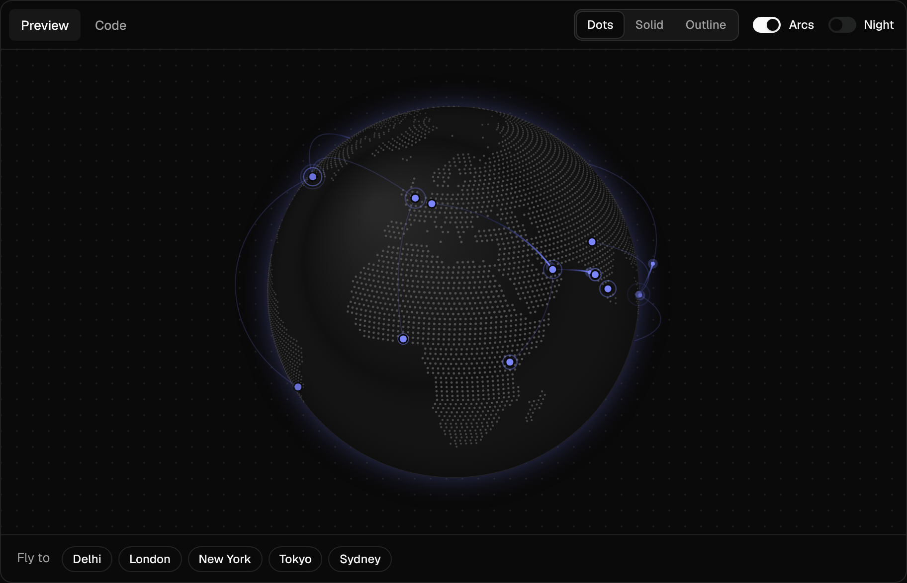

# Meridian UI

Animated, themeable React components for maps and globes. Dotted or solid land, choropleth data, pulsing markers and travelling arcs, all drawn locally with d3-geo. No tile server, no API keys.



| India map | Continent maps |
| --- | --- |
|  |  |
| **World map** | **Globe (dark)** |
|  |  |

| Component | What it is |
| --- | --- |
| `Globe` | Canvas orthographic globe. Dotted, solid or outline land; drag with inertia; arcs that lift off the surface; fly-to; day/night shading. |
| `WorldMap` | Every country on Equal Earth (or Natural Earth, Mercator, equirectangular). Hex dot lattice or solid fills, markers, arcs, choropleth, zoom. |
| `IndiaMap` | All 28 states and 8 union territories on official boundaries. Keys by state name or ISO 3166-2 code (`"MH"`, `"KA"`, …). |
| `ContinentMap` | One continent per map, each with its own equal-area projection. Presets: `AfricaMap`, `AsiaMap`, `EuropeMap`, `NorthAmericaMap`, `SouthAmericaMap`, `OceaniaMap`, `AntarcticaMap`. |
| `MapLegend` | Sequential ramp or categorical key using the same tokens. |
| `MapControls` | Zoom in / out / reset buttons (built into zoomable maps). |

## Install

```bash
npm install github:NamanSharma2112/Maps
```

The `prepare` script builds `dist/` on install. Peer dependencies: `react` and `react-dom` 18 or later.

```tsx
import { Globe, WorldMap, IndiaMap, AfricaMap } from "meridian-ui";
import "meridian-ui/styles.css";
```

## Usage

```tsx
<Globe
  markers={[{ lat: 28.61, lng: 77.21, label: "New Delhi" }]}
  arcs={[{ from: { lat: 51.51, lng: -0.13 }, to: { lat: 40.71, lng: -74.01 } }]}
  autoRotate={8}
/>

<WorldMap variant="dots" markers={offices} arcs={routes} zoomable />

<IndiaMap
  data={{ "Uttar Pradesh": 199812341, Maharashtra: 112374333 }}
  valueLabel="Population"
  legend="Population, Census 2011"
  labels
  zoomable
  onRegionClick={(state) => console.log(state.id, state.name, state.value)}
/>

<ContinentMap continent="europe" variant="dots" />
```

### Shared map props

`WorldMap`, `IndiaMap` and `ContinentMap` share these props:

| Prop | Type | Default | |
| --- | --- | --- | --- |
| `variant` | `"solid" \| "dots"` | world: `"dots"`, others: `"solid"` | Filled regions or a hexagonal dot lattice |
| `data` | `Record<string, number>` | | Values keyed by region name or id. Turns on the choropleth |
| `scale` | `"quantile" \| "linear"` | `"quantile"` | How values are binned |
| `steps` / `colors` | `number` / `string[]` | `5` | Number of bins, or your own colors |
| `valueLabel`, `formatValue` | | | Tooltip and legend text |
| `legend` | `boolean \| string` | `false` | Legend for `data`; a string titles it |
| `markers` | `MapMarker[]` | `[]` | `{ lat, lng, label?, color?, size?, pulse?, labelPosition?, description? }` |
| `arcs` | `MapArc[]` | `[]` | `{ from, to, color?, delay? }` |
| `markerPulse` | `"always" \| "hover" \| "none"` | `"always"` | |
| `zoomable` | `boolean` | `false` | Wheel zoom, drag to pan, click a region to fly to it, double-click to zoom |
| `selected` | `string \| null` | | Outline one region |
| `onRegionClick`, `onRegionHover` | `(region) => void` | | `{ id, name, value }` |
| `dotGap` | `number` | `7` | Pixels between dots |
| `renderTooltip` | `(region) => ReactNode` | | Custom tooltip body |

## Theming

Every color is a CSS variable. Add `.dark` or `data-theme="dark"` to any ancestor for the dark palette, or override tokens:

```css
:root {
  --mr-accent: oklch(0.585 0.233 277.117); /* markers, arcs, data ramp */
  --mr-land: oklch(0.922 0 0);             /* solid land, empty bins */
  --mr-dot: oklch(0.80 0 0);               /* dotted land */
  --mr-ocean: oklch(0.985 0 0);            /* globe sphere */
  --mr-atmosphere: oklch(0.585 0.233 277.117 / 0.14);
}
```

All animation stops under `prefers-reduced-motion`.

## Development

```bash
npm install
npm run dev        # docs site with live previews
npm test           # data and geometry tests
npm run build      # library (dist/) + docs site (dist-demo/)
```

## Data

- Countries and land: [Natural Earth](https://www.naturalearthdata.com/) 1:110m via [world-atlas](https://github.com/topojson/world-atlas). Public domain.
- **India is drawn on its official boundary in every component** (`Globe`, `WorldMap`, `ContinentMap`, `IndiaMap`): all of Jammu & Kashmir and Ladakh, including PoK, Gilgit-Baltistan, Aksai Chin and the Shaksgam Valley, plus Arunachal Pradesh, as depicted by the Survey of India. `scripts/build-world.mjs` replaces Natural Earth's India with the outline of the 36 states and union territories and trims neighbouring countries to fit around it; tests check the disputed areas fall inside India.
- Indian states and union territories: [DataMeet India community](https://github.com/datameet/maps) "Admin2", simplified. [CC BY 4.0](https://creativecommons.org/licenses/by/4.0/). `IndiaMap` shows this credit by default.

## License

MIT
